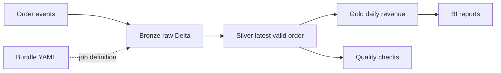

# E-commerce Databricks Lakehouse
Personal portfolio starter for orders and revenue analytics with a Databricks bundle-style job definition. The local demo and tests run with Python and SQLite. The Spark and bundle files are reference examples and have not been deployed or validated against an Azure workspace.



## Quick start
```bash
python src/local_demo.py
python -m unittest discover -s tests -v
```
`data/orders.csv` is synthetic. A cancelled order is excluded from paid revenue. Updated orders are selected by latest event time; same-time conflicting payloads need a source-specific policy in production.

## Databricks reference deployment
Review `databricks.yml` and `resources/ecommerce_job.yml`, configure a workspace and authentication, provide permitted cluster settings and an input CSV path. From the project root, run `databricks bundle validate -t dev`, then deploy and run only after validation. Cloud execution has not been verified. The notebook overwrites demo tables in the current configured schema; use a dedicated development schema, never production.

## Scope
This starter focuses on orders and daily revenue. Customer, inventory and web-event feeds, SCD2, streaming, CI/CD and dashboard deployment are planned extensions, not completed claims. Review, run and adapt the code before presenting it as your own hands-on work. Record actual test and workspace evidence in `docs/evidence.md`.
